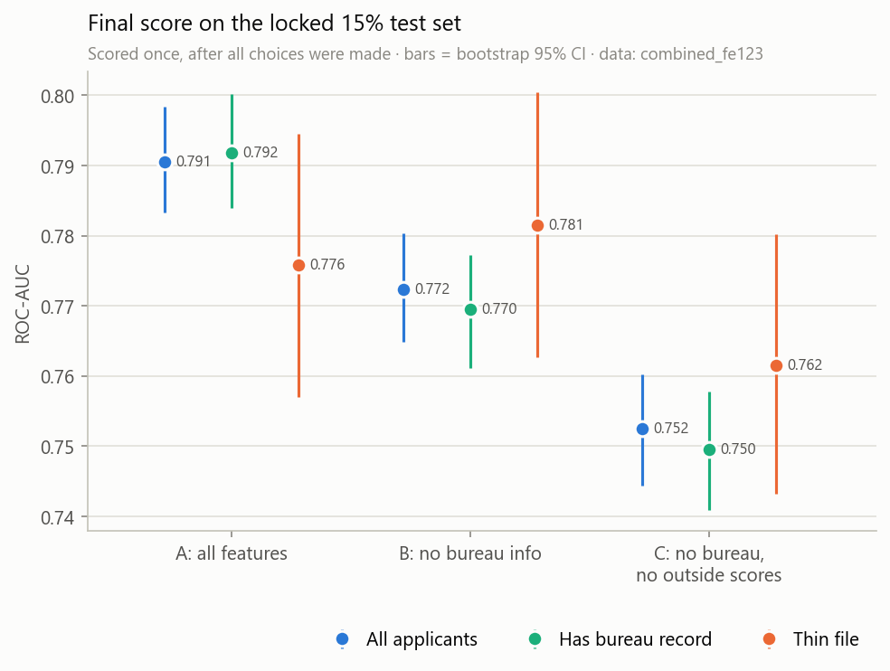
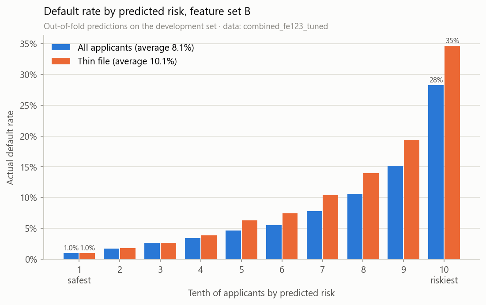
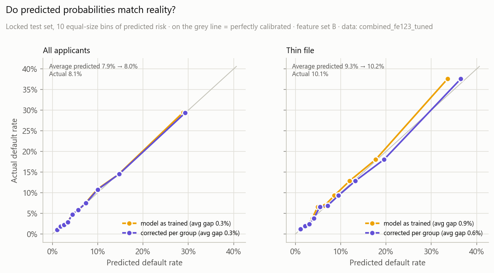
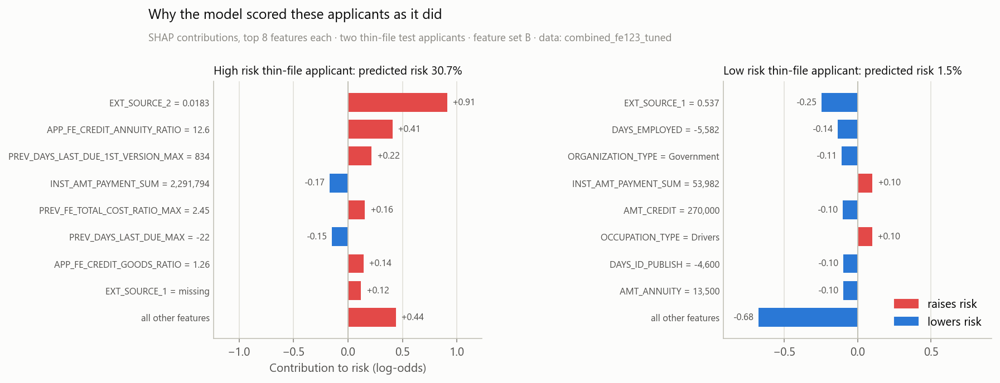

# Thin-File Borrowers

**Can you judge loan risk for people the credit bureau knows nothing about?** A credit risk model for "thin-file" applicants (people with no credit bureau record), built on 307,511 real loan applications from Home Credit.

Thin-file applicants are about 1 in 7 of all applicants, and they default more often. The model ranks every applicant by risk without any credit bureau data: it uses the application, the applicant's past loans and payments with Home Credit, and outside credit scores. It explains each score feature by feature, and it was tested on a locked set of 46,127 applicants it never saw.



AUC is the chance that the model scores a random defaulter as riskier than a random good payer: 0.5 is a coin flip, 1.0 is perfect.

## Key findings

- **Thin-file applicants are riskier, but not harder to rank.** They default at 10.1% vs 7.7% for everyone else. Without bureau data, the model ranks them at least as well as everyone else (test AUC 0.785 vs 0.774).
- **The gap comes from the bureau data, not the applicants.** Bureau data lifts AUC for applicants who have a record (0.774 to 0.793) and does nothing for those who don't. That is why thin-file applicants look harder to score when everyone is scored together.
- **The lender's own history and outside scores fill in.** 94% of thin-file applicants have applied to Home Credit before, and their past loan costs and repayments are among the top features. Removing the outside scores lowers their AUC from 0.785 to 0.765.
- **Leaving gender out doesn't make a model gender-neutral.** Gender is not an input, and men and women are ranked equally well (AUC 0.773 vs 0.772). But men's risk is under-predicted (9.3% vs 10.2% actual), and at one shared cutoff 21% of good-paying men are flagged against 15% of women.

## Highlights

- **Honest evaluation.** 15% of applicants were locked away before any modelling and scored once per version, at the end. With all features, test AUC is 0.793 (0.5 = coin flip; one outside score alone gets 0.663), in line with cross-validation (0.789).
- **Tuned, calibrated and explained.** Tuning on the development set lifted AUC for all applicants in every fold. Predicted default rates match reality overall (7.9% vs 8.1%), but thin-file applicants were under-predicted (9.3% vs 10.1%), so they get their own correction (10.2%). SHAP values show why each applicant got their score.
- **Improved after finding a flaw in my own work.** My first "no bureau data" model still contained bureau enquiry counts, which are missing for 94% of thin-file applicants and almost never for anyone else. That let the model tell who was thin-file, so I moved them to the bureau group and reran everything. See [Version history](docs/technical.md#version-history).

**Tech stack:** Python, pandas, NumPy, LightGBM, Optuna, SHAP (TreeSHAP in LightGBM), scikit-learn, matplotlib, pytest.

## Results

| Feature set | What the model sees | Test AUC, all | Test AUC, thin file |
|---|---|---|---|
| A | everything | 0.793 | 0.782 |
| B | no bureau data | 0.776 | 0.785 |
| C | no bureau data, no outside scores | 0.756 | 0.765 |

<p>
  
  
</p>

Left: the riskiest tenth of applicants default at 28% (35% for thin-file), against 1% for the safest tenth. Right: predicted and actual default rates line up once thin-file applicants get their own correction.



Why the model scored two thin-file applicants as it did: red features raised their predicted risk, blue ones lowered it.

## Run it

Needs the Kaggle CSVs (about 2.5 GB) in `dataset/`.

```bash
pip install -r requirements.txt
python -m src.preprocess --batches 1 2 3          # build the dataset
python -m src.train --features B --params tuned   # 5-fold cross-validation
```

Every experiment, the final test scores, the checks and the charts: [docs/technical.md](docs/technical.md#running-and-retraining).

## Data

[Home Credit Default Risk](https://www.kaggle.com/competitions/home-credit-default-risk/data) (Kaggle, 2018): 307,511 labelled loan applications across 7 linked tables, of which 44,020 are thin-file. Used under the competition [rules](https://www.kaggle.com/competitions/home-credit-default-risk/rules).

## Limitations

- **Approved loans only**: outcomes exist only for people who got a loan, not for those turned away.
- **Not brand-new customers**: almost all thin-file applicants have a history with Home Credit itself.
- **Small thin-file test group**: 6,534 applicants, so thin-file AUCs carry a ±0.02 margin.
- **Group gaps found, not fixed**: the gender and age differences are measured, not corrected.

**Next steps** that would improve it: reject inference to include declined applicants, a fairness fix tested against its cost in accuracy, and checking the model on a later time period.

Method, evaluation, tuning, calibration, fairness, project layout and version history: [docs/technical.md](docs/technical.md)
