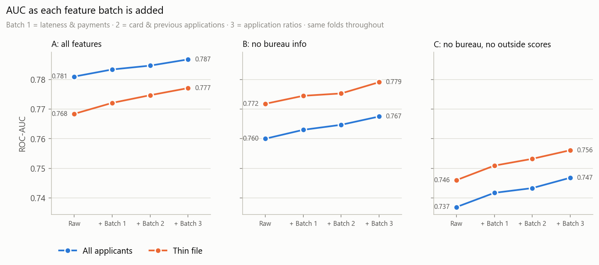

# Thin-File Borrowers

**Can you judge loan risk for people with no credit history?** A credit risk model for "thin-file" applicants (people with no credit bureau record), built on 307,511 real loan applications from Home Credit.

Thin-file applicants are about 1 in 7 of all applicants, and they default more often. The model ranks every applicant by risk using only what the lender itself knows: the application and the applicant's past loans and payments with Home Credit. It was tested on a locked set of 46,127 applicants it never saw.


## Key findings

- **Thin-file applicants are riskier, but not harder to rank.** They default at 10.1% vs 7.7% for everyone else. Without bureau data, the model ranks them at least as well as everyone else (test AUC 0.781 vs 0.770).
- **The gap comes from the bureau data, not the applicants.** Bureau data lifts AUC for applicants who have a record (0.770 to 0.792) and does nothing for those who don't. That is the whole reason thin-file applicants look harder to score.
- **The lender's own history stands in for the bureau.** 94% of thin-file applicants have applied to Home Credit before. Past loan costs, credit card use and late payments with Home Credit are among the model's top 15 features.
- **Outside credit scores still help.** Removing the two outside scores that thin-file applicants have lowers their AUC from 0.781 to 0.762.

## Highlights

- **Honest evaluation.** 15% of applicants were locked away before any modelling and scored once, at the end. Overall test AUC is 0.791 (0.5 = coin flip), within 0.006 of cross-validation.
- **Every change tested fold by fold.** Each batch of hand-made features was compared with the version before it on the same five folds (overall AUC 0.781 to 0.787). Removing features to cut noise was tested too, and gained nothing (within ±0.001).
- **Improved after finding a flaw in my own work.** My first "no bureau data" model still contained bureau enquiry counts, which are missing for 94% of thin-file applicants and almost never for anyone else. That let the model tell who was thin-file, so I moved them to the bureau group and reran everything. See [Version history](docs/technical.md#version-history).

**Tech stack:** Python, pandas, NumPy, LightGBM, scikit-learn, matplotlib, pytest.

## Results

<p>
  
  
</p>

Left: in cross-validation, the riskiest tenth of applicants default at 28% (35% for thin-file), against 1% for the safest tenth. Right: each batch of hand-made features raised AUC for every feature set.

| Feature set | What the model sees | Test AUC, all | Test AUC, thin file |
|---|---|---|---|
| A | everything | 0.791 | 0.776 |
| B | no bureau data | 0.772 | 0.781 |
| C | no bureau data, no outside scores | 0.752 | 0.762 |

## Run it

Needs the Kaggle CSVs (about 2.5 GB) in `dataset/`.

```bash
pip install -r requirements.txt
python -m src.preprocess --batches 1 2 3   # build the dataset
python -m src.train --features B           # 5-fold cross-validation
```

Every experiment, the final test scores and the charts: [docs/technical.md](docs/technical.md#running-and-retraining).

## Data

[Home Credit Default Risk](https://www.kaggle.com/competitions/home-credit-default-risk/data) (Kaggle, 2018): 307,511 labelled loan applications across 7 linked tables, of which 44,020 are thin-file. Used under the competition [rules](https://www.kaggle.com/competitions/home-credit-default-risk/rules).

## Limitations

- **Approved loans only**: outcomes exist only for people who got a loan, not for those turned away.
- **Not brand-new customers**: almost all thin-file applicants have a history with Home Credit itself.
- **Small thin-file test group**: 6,534 applicants, so thin-file AUCs carry a ±0.02 margin.
- **One lender**: one company's customers and products, so results may not transfer elsewhere.

**Next steps** that would improve it: hyperparameter tuning, SHAP explanations for individual decisions, a fairness check across groups, and probability calibration.

Method, evaluation, results, project layout and version history: [docs/technical.md](docs/technical.md)
